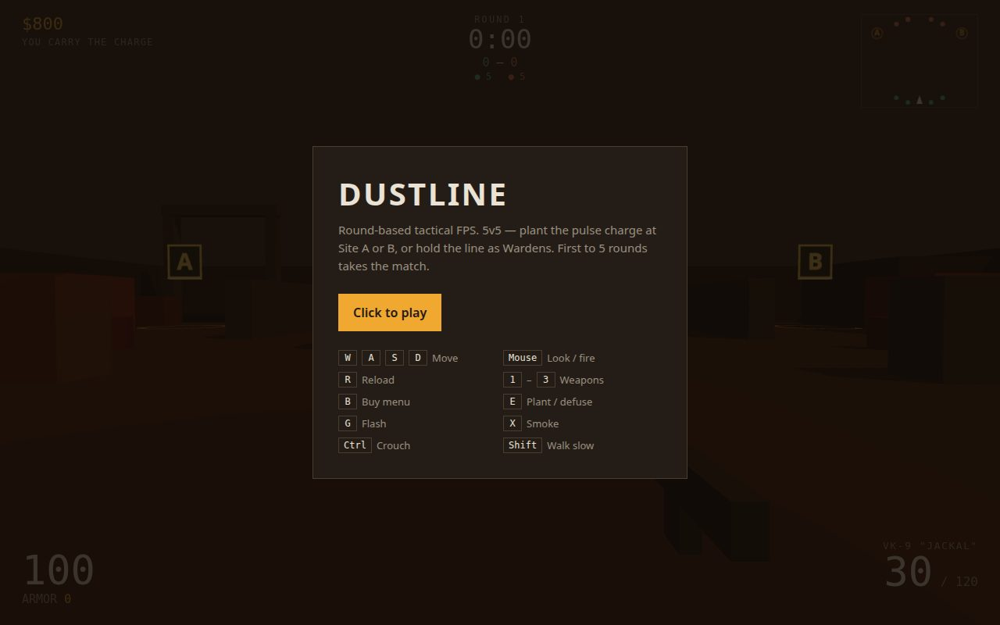

# DUSTLINE — round-based tactical FPS



**DUSTLINE** is a round-based tactical FPS built on [three.js](https://threejs.org/) for make.fun's
["Make the best three.js tactical FPS"](https://make.fun/bounty/threejs-fps-01) bounty ($1,000 in USDC).

5v5 on the original three-lane map **Rustworks**: the **Vanguard** attack, carrying a pulse charge to
plant at Site A (crane yard) or Site B (warehouse); the **Wardens** defend. First to 5 round wins
takes the match. Rounds last 100 seconds; a planted charge detonates after 40 seconds unless defused.

## How it plays

- **Objective:** carry the charge (you start with it), hold **E** for 3.5 s at a site to plant; defenders hold **E** for 5 s to defuse. The charge beeps faster as the timer runs out.
- **Economy:** start with $800; kills pay $300, round wins $3,250, losses $1,900 (+$500 per loss in a row). Press **B** during the buy phase to spend it.
- **Arsenal (fictional):** VK-9 "Jackal" rifle, Hornet-9 SMG, Longshot .50 sniper, Sidewinder pistol, plus flashbang and smoke grenades. Headshots deal double damage; spraying and firing on the move widens your spread — stop to aim.
- **Bots:** 9 AI combatants with waypoint routes over the three lanes, line-of-sight perception, reaction times, burst fire, and objective behaviour — attackers push sites and plant, defenders hold and rotate to defuse.
- **HUD:** health/armor, ammo, round timer, score, alive counts, money, dynamic crosshair, hitmarker, kill feed, round banners, plant/defuse bar, and a live minimap.
- **Sound:** everything is synthesized with WebAudio — shots, reloads, footsteps, plant beeps, explosions. No audio files, no network.

## Run it

```sh
node serve.ts
# open http://localhost:8080 — click to play
```

No build step, no dependencies beyond the vendored three.js (0.187.0) in `game/vendor/three/`.
Screenshots are deterministic frames: open `http://localhost:8080/?shot=menu&seed=1` (or `play`, `plant`, `win`) and wait for `window.__shotReady`.

## Controls

| Key | Action |
| --- | --- |
| WASD + mouse | Move / look (click captures the pointer) |
| Click | Fire |
| R | Reload |
| 1 / 2 / 3 | Jackal / Hornet / Longshot |
| B | Buy menu (buy phase) |
| E (hold) | Plant / defuse |
| G / X | Throw flashbang / smoke |
| Ctrl | Crouch |
| Shift | Walk slow |

## Known limits

- Pointer lock needs a click on the game first; without it the mouse does
  not turn the camera (keyboard still works).
- Audio starts on the first click, as browsers require a gesture.
- Bot difficulty is fixed; there is no settings screen yet.

## License

MIT — see [LICENSE](LICENSE).
